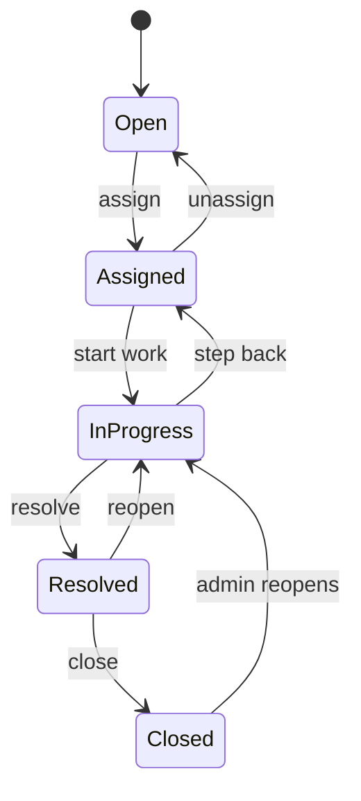
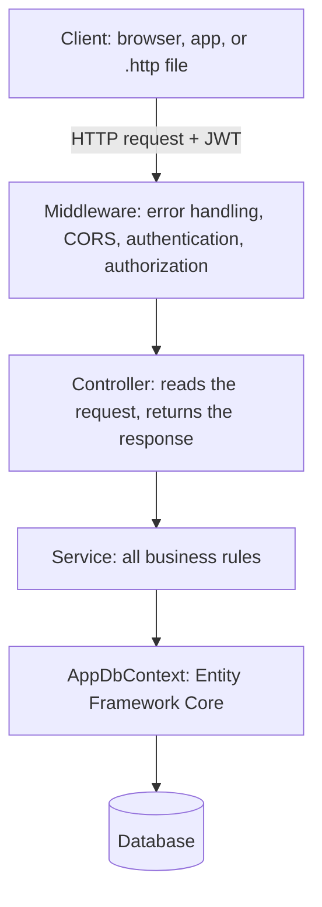
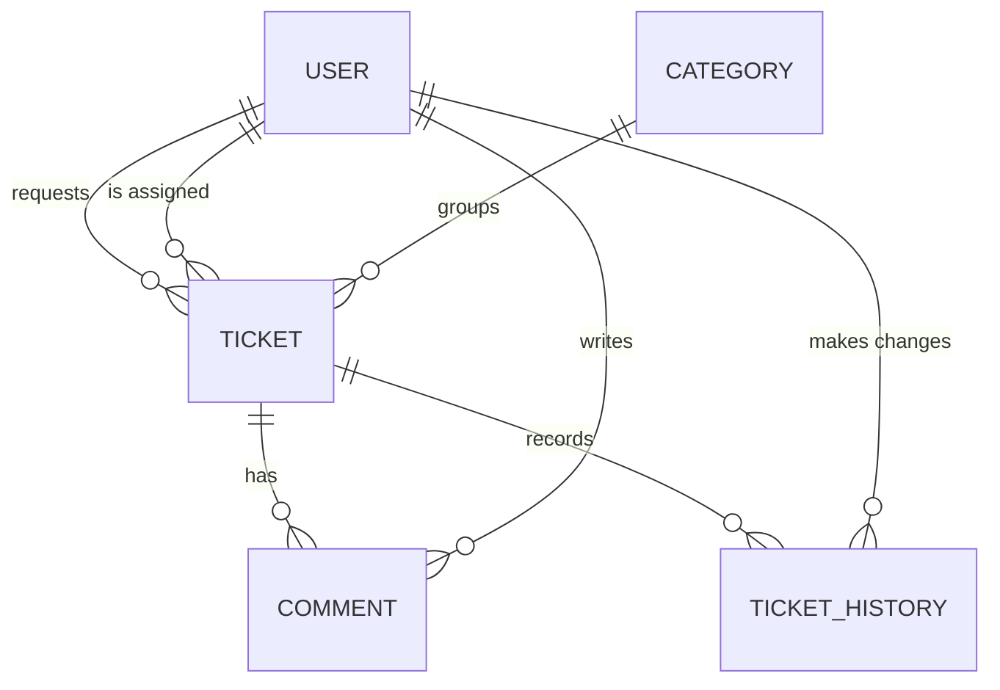
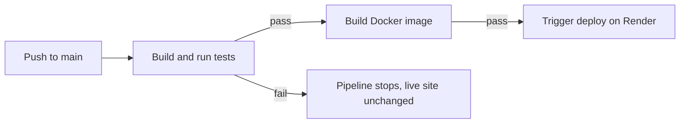

# HelpDeskPro_dotnet
# HelpDesk Pro


**An IT support ticket system (REST API) built with ASP.NET Core.**
Employees report problems, support agents work on them, admins manage everything, and every change is recorded.

> **Live demo:** `https://helpdeskpro-dotnet.onrender.com/openapi/v1.json` (API description) | `https://helpdeskpro-dotnet.onrender.com/health`
> The demo runs on a free plan: the first request after a quiet period can take about a minute, and demo data resets when the service restarts.

---

## Table of contents

1. [What is this project?](#what-is-this-project)
2. [Features](#features)
3. [Roles and permissions](#roles-and-permissions)
4. [Ticket lifecycle](#ticket-lifecycle)
5. [Tech stack](#tech-stack)
6. [How it is built](#how-it-is-built)
7. [Database design](#database-design)
8. [API endpoints](#api-endpoints)
9. [Getting started](#getting-started)
10. [Run with Docker](#run-with-docker)
11. [Try the API](#try-the-api)
12. [Testing](#testing)
13. [CI/CD pipeline](#cicd-pipeline)
14. [Configuration](#configuration)
15. [Security](#security)
16. [Design decisions](#design-decisions)
17. [Limitations and roadmap](#limitations-and-roadmap)

---

## What is this project?

Imagine a company where an employee's laptop stops working:

1. The employee **creates a ticket** describing the problem.
2. A support agent **picks it up** (assigns it to themselves).
3. The agent **works on it**, adds notes, and marks it **resolved**.
4. The employee **closes** the ticket.

HelpDesk Pro is the back end that makes this work. It decides **who can do what**, enforces the **steps a ticket must follow**, calculates **due dates** from priority, and keeps a **history** of every change.

It has no screen of its own. It is an API: other programs (a website, a mobile app, or the `.http` files in this repo) talk to it over HTTP.

---

## Features

- **Accounts and login** with JWT tokens; passwords are stored as BCrypt hashes
- **Three roles:** Requester, Agent, Admin
- **Tickets:** create, view, edit, assign, change status
- **Enforced lifecycle:** a ticket can only move through allowed steps
- **Priorities and due dates:** Low, Medium, High, Critical, each with an SLA due time
- **Comments:** public replies and internal notes that requesters never see
- **Ticket history:** every status, assignee, and priority change is recorded (who, when, old value, new value)
- **Search, filter, sort, and pagination** on the ticket list
- **Admin tools:** change roles, deactivate and reactivate users
- **Dashboard statistics:** totals, overdue tickets, average resolution time, agent workload
- **Clean error responses:** consistent JSON for 400, 401, 403, and 404
- **Health check** endpoint for hosting platforms
- **Automated tests** (59) and a **CI pipeline** on every push
- **Docker** support

---

## Roles and permissions

| Action | Requester | Agent | Admin |
|---|:---:|:---:|:---:|
| Register and log in | Yes | Yes | Yes |
| Create a ticket | Yes | Yes | Yes |
| See tickets | Own only | All | All |
| Edit a ticket | Own, while still Open (no priority change) | Yes | Yes |
| Assign a ticket | No | To self only | To anyone, or unassign |
| Change status | Close own Resolved ticket | Tickets assigned to them | Any |
| Reopen a Closed ticket | No | No | Yes |
| Public comment | Own tickets | Yes | Yes |
| Internal note | No | Yes | Yes |
| View history | Own tickets | Yes | Yes |
| Dashboard statistics | No | Yes | Yes |
| Manage users | No | No | Yes |

Anyone who registers becomes a **Requester**. Only an Admin can promote a user.

---

## Ticket lifecycle



**Business rules**

1. Only the moves shown above are allowed; anything else returns `400`.
2. A ticket can only be Closed after it was Resolved.
3. Moving to In Progress or Resolved requires an assigned agent.
4. The assignee must be an active Agent or Admin.
5. Closed tickets cannot be edited or commented on; only an Admin can reopen them.
6. Assigning an Open ticket moves it to Assigned automatically.
7. Every change to status, assignee, or priority writes a history row.

**Due dates (SLA)** are set from priority and recalculated if an agent changes the priority:

| Priority | Due after |
|---|---|
| Critical | 4 hours |
| High | 8 hours |
| Medium | 24 hours |
| Low | 72 hours |

---

## Tech stack

| Area | Technology |
|---|---|
| Language and framework | C#, ASP.NET Core Web API (.NET 10) |
| Database access | Entity Framework Core with migrations |
| Database | SQLite (SQL Server planned, see roadmap) |
| Authentication | JWT bearer tokens, BCrypt password hashing |
| Testing | xUnit with in-memory SQLite |
| API description | OpenAPI |
| Containers | Docker, Docker Compose |
| CI/CD | GitHub Actions |
| Hosting | Render |

---

## How it is built

A request passes through the same layers every time:



| Layer | Job |
|---|---|
| **Controllers** | Thin. Read input, get the caller from the token, call a service, return a result |
| **Services** | Hold all rules: permissions, status transitions, history, SLA |
| **DbContext** | Translates C# queries (LINQ) into SQL |
| **DTOs** | Define what goes in and out of the API, so clients can never set fields like `Status` or `Role` directly |
| **Exception handler** | Services throw simple exceptions; one handler turns them into 404, 403, or 400 responses |

### Project structure

```
HelpDeskPro/
├── Controllers/        Auth, Tickets, Comments, Users, Categories, Dashboard
├── Services/           AuthService, TicketService, CommentService,
│                       TicketWorkflow (allowed moves), Sla (due dates), ClaimsExtensions
├── Models/             Entities and enums (User, Ticket, Comment, ...)
├── Dtos/               Request and response shapes
├── Data/               AppDbContext, DbSeeder (creates the first admin)
├── Middleware/         Custom exceptions and global error handler
├── Migrations/         Database migrations (generated)
├── HelpDeskPro.Tests/  xUnit tests
├── Program.cs          Startup: services, authentication, pipeline
├── Dockerfile
├── docker-compose.yml
└── .github/workflows/ci.yml
```

---

## Database design



| Table | Purpose |
|---|---|
| Users | Name, email (unique), password hash, role, active flag |
| Tickets | Title, description, status, priority, due date, requester, assigned agent |
| Categories | Hardware, Software, Network, Access and Accounts, Other (seeded) |
| Comments | Text, author, internal flag |
| TicketHistories | Field, old value, new value, who changed it, when |

Tickets are never deleted, so the audit trail stays complete.

---

## API endpoints

| Method and path | Who | Purpose |
|---|---|---|
| `POST /api/auth/register` | Anyone | Create a Requester account |
| `POST /api/auth/login` | Anyone | Get a token |
| `GET /api/auth/me` | Logged in | Show who you are |
| `GET /api/tickets` | Logged in | List tickets (filtered, sorted, paged) |
| `GET /api/tickets/{id}` | Logged in | One ticket |
| `POST /api/tickets` | Logged in | Create a ticket |
| `PUT /api/tickets/{id}` | Logged in | Edit a ticket |
| `POST /api/tickets/{id}/assign` | Agent, Admin | Assign or unassign |
| `POST /api/tickets/{id}/status` | Logged in | Change status |
| `GET /api/tickets/{id}/history` | Logged in | Audit trail |
| `GET` / `POST /api/tickets/{id}/comments` | Logged in | Read and add comments |
| `GET /api/categories` | Logged in | List categories |
| `GET /api/users` | Admin | List users |
| `PUT /api/users/{id}/role` | Admin | Change a role |
| `PUT /api/users/{id}/deactivate` and `/activate` | Admin | Disable or enable a user |
| `GET /api/dashboard/stats` | Agent, Admin | Statistics |
| `GET /health` | Anyone | Health check |

**Listing tickets** supports these query parameters: `status`, `priority`, `assignedTo`, `unassigned`, `overdue`, `search`, `sortBy` (`createdAt`, `dueAt`, `priority`, `updatedAt`), `sortDir` (`asc`, `desc`), `page`, `pageSize` (1 to 50).

```
GET /api/tickets?status=Open&priority=High&search=laptop&sortBy=dueAt&sortDir=asc&page=1&pageSize=10
```

Response shape:

```json
{ "items": [ ... ], "page": 1, "pageSize": 10, "totalCount": 42, "totalPages": 5 }
```

---

## Getting started

### Requirements

- [.NET 10 SDK](https://dotnet.microsoft.com/download)
- Git
- (Optional) [Docker Desktop](https://www.docker.com/products/docker-desktop/)
- (Optional) VS Code with the **REST Client** extension

### Run locally

```bash
git clone https://github.com/YOUR_USER/YOUR_REPO.git
cd YOUR_REPO

# Store secrets outside the project (they never go into Git)
dotnet user-secrets init
dotnet user-secrets set "Jwt:Key" "use-a-long-random-string-of-at-least-32-characters"
dotnet user-secrets set "Seed:AdminPassword" "choose-a-strong-password"

dotnet run
```

On first start the app creates the SQLite database, applies migrations, adds the categories, and creates an admin account:

- Email: `admin@helpdesk.local`
- Password: the value you set for `Seed:AdminPassword`

The console prints the address it listens on (for example `http://localhost:5146`).

---

## Run with Docker

1. Copy `.env.example` to `.env` and fill in the two values:

```
JWT_KEY=a-long-random-string-of-at-least-32-characters
ADMIN_PASSWORD=choose-a-strong-password
```

2. Start it:

```bash
docker compose up --build
```

3. Open `http://localhost:8080/health`. It should say `Healthy`.

The database lives in a Docker volume, so your data survives restarts. Use `docker compose down -v` to wipe it.

| Concept | In this project |
|---|---|
| `Dockerfile` | Two-stage build: the SDK compiles the app, a small runtime image runs it |
| Image | The packed app plus the .NET runtime |
| Container | The running app |
| Volume | Storage for the database outside the container |
| `.env` | Secrets handed to the container at start (never committed) |

---

## Try the API

The repository includes `.http` files (for the VS Code REST Client extension) with ready-made requests for each feature. Open one, set `@baseUrl`, and click **Send Request**.

Quick example:

```http
### Register
POST http://localhost:5146/api/auth/register
Content-Type: application/json

{ "name": "Ali Perera", "email": "ali@test.com", "password": "Passw0rd!" }

### Log in (copy the token from the response)
POST http://localhost:5146/api/auth/login
Content-Type: application/json

{ "email": "ali@test.com", "password": "Passw0rd!" }

### Create a ticket
POST http://localhost:5146/api/tickets
Authorization: Bearer PASTE_TOKEN_HERE
Content-Type: application/json

{
  "title": "Laptop will not boot",
  "description": "Black screen after the Windows logo appears.",
  "categoryId": 1,
  "priority": "High"
}
```

To try the agent features, log in as the admin and promote a user with `PUT /api/users/{id}/role` and `{ "role": "Agent" }`. That user must log in again, because the role is stored inside the token.

---

## Testing

```bash
dotnet test
```

**59 automated tests** run against a real in-memory SQLite database (a fresh one for every test).

| Test group | What it protects |
|---|---|
| SLA | Due date hours for every priority |
| Workflow | Every allowed and forbidden status move |
| Ticket service | Visibility rules, paging, sorting, create, update, assign, status permissions, history |
| Comment service | Internal notes never reach requesters; closed tickets reject comments |

---

## CI/CD pipeline

Every push to `main` runs this pipeline in GitHub Actions:



If a test fails, nothing is deployed. Pull requests run the tests and the Docker build but do not deploy.

---

## Configuration

Settings come from `appsettings.json`, user secrets, or environment variables. In environment variables a double underscore replaces the colon (`Jwt:Key` becomes `Jwt__Key`).

| Setting | Purpose |
|---|---|
| `ConnectionStrings__Default` | Database connection (for example `Data Source=helpdesk.db`) |
| `Jwt__Key` | Secret used to sign tokens (32+ characters, keep private) |
| `Jwt__Issuer`, `Jwt__Audience` | Token validation values |
| `Seed__AdminPassword` | Password for the seeded admin account |
| `Cors__Origins__0` | Website address allowed to call the API from a browser |
| `EnableDocs` | `true` exposes the OpenAPI description outside development |
| `PORT` | Port used by some hosting platforms |

---

## Security

- Passwords are hashed with BCrypt, never stored in readable form.
- Registration always creates a Requester, so nobody can sign up as an Admin.
- Login failures return the same message whether the email or password was wrong, and are logged.
- Tokens expire after 2 hours and are signed with a secret that is never committed.
- Deactivated users are blocked immediately, even if their token is still valid.
- Requesters get `404` for tickets they do not own, so ticket IDs cannot be guessed.
- Internal notes are filtered inside the database query for requesters.
- Clients send DTOs, so they cannot set fields such as role, status, or due date directly.
- Unexpected errors return a generic `500` and the details go to the logs only.

---

## Design decisions

| Decision | Reason |
|---|---|
| Service layer | Rules live in one place and can be tested without HTTP |
| Pure `TicketWorkflow` and `Sla` classes | No database needed, so they are trivial to test |
| Separate "valid move" (400) and "allowed person" (403) checks | They are different questions with different errors |
| History written in the same save as the change | The change and its audit record succeed or fail together |
| Visibility filter applied first | No combination of filters can expose another user's tickets |
| Whitelisted sort columns, tie-breaker by ID | Safe input and stable pages |
| Real in-memory SQLite in tests instead of mocks | Catches query and constraint problems that mocks hide |
| Settings from the environment | The same image runs anywhere, and secrets stay out of Git |

---

## Limitations and roadmap

**Current limitations**

- The database is SQLite. On the free demo host it resets when the service restarts.
- There is no user interface yet; the API is used through `.http` files or the OpenAPI description.
- Role changes need a fresh login because the role lives inside the token.

**Planned**

- [ ] Move the database to SQL Server (Docker for development)
- [ ] React front end with light and dark themes
- [ ] Refresh tokens
- [ ] Integration tests with `WebApplicationFactory`
- [ ] Application monitoring and alerts
- [ ] Dependency scanning with Dependabot


